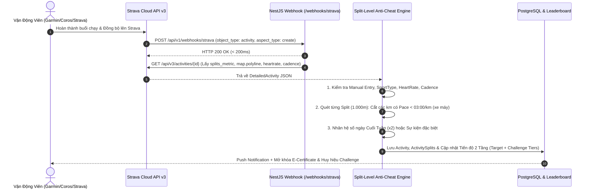

# 🏛️ Tài Liệu Kiến Trúc Chi Tiết Hệ Thống TOPRunAssistant (`ARCHITECTURE.md`)

Tài liệu này mô tả chi tiết thiết kế kiến trúc phần mềm, luồng xử lý dữ liệu từ Strava API, thuật toán chống gian lận cấp độ từng km (Split-Level Anti-Cheat) và mô hình tích lũy 2 tầng (**Target** vs **Challenge Tiers**) của **TOPRunAssistant**.

---

## 1. Tổng Quan Kiến Trúc Đa Nền Tảng (Android, iOS, Web)

Hệ thống được tổ chức theo mô hình **Full-Stack TypeScript Monorepo (Turborepo)** gồm 5 thành phần cốt lõi:

1. **`packages/shared` (`@toprun/shared`)**:
   - Chứa toàn bộ **Domain Logic thuần túy (Pure Functions)** dùng chung cho cả Backend, Web và Mobile.
   - Bao gồm: Bộ kiểm duyệt từng km `evaluateActivitySplits()`, bộ tính toán tiến độ kép `calculateDualGoalProgress()`, bộ giải mã & dựng hình bản đồ `decodePolyline()` / `polylineToSvgPath()`, và bộ đọc file `parseGpxToActivityInput()`.
2. **`packages/database` (`@toprun/database`)**:
   - Quản lý **Prisma Schema** kết nối cơ sở dữ liệu **PostgreSQL 16** (15 bảng thực thể quan hệ chuẩn hóa) kèm script khởi tạo dữ liệu mẫu (`prisma/seed.ts`).
3. **`apps/api` (`@toprun/api` - NestJS)**:
   - Cung cấp RESTful API chuẩn OpenAPI/Swagger (`/api/docs`), xử lý OAuth2 liên kết Strava, nhận sự kiện thời gian thực từ **Strava Webhook**, sinh ảnh Vector SVG cho **E-BIB** & **E-Certificate**, quản lý kiểm duyệt chống gian lận và đơn hàng Race-kit.
4. **`apps/web` (`@toprun/web` - Next.js 15 App Router + TailwindCSS)**:
   - Tích hợp cả **Giao diện Vận động viên (Runner Web App)** và **Cổng Quản trị viên / Ban tổ chức (Admin & Organizer Portal)**.
5. **`apps/mobile` (`@toprun/mobile` - React Native Expo)**:
   - Ứng dụng di động biên dịch gốc cho **Android** và **iOS**, chia sẻ 100% logic tính toán từ `@toprun/shared`.

---

## 2. Luồng Đồng Bộ Tracklog Từ Strava API & Xử Lý GPX

---

## 3. Thuật Toán Chống Gian Lận Từng Km (Split-Level Anti-Cheat)

Một vấn đề rất phổ biến ở các giải chạy ảo là VĐV chạy bộ thực tế 5km–10km, nhưng sau khi chạy xong lại **quên bấm dừng đồng hồ/Strava và lên xe máy đi về nhà** (khiến 1–2km cuối có tốc độ 35–45 km/h, tương đương Pace `01:20/km` – `01:45/km`).

- Nếu hủy toàn bộ buổi chạy: VĐV mất oan 5–10km chạy bộ hợp lệ trước đó.
- Nếu tính trung bình cả buổi: VĐV gian lận được thêm số km đi xe máy.

**Giải pháp của TOPRunAssistant (`packages/shared/src/scoring.ts`)**:
1. Duyệt qua từng phần tử trong mảng `splits` (mỗi km là 1 split):
   - Tính $\text{Pace (giây/km)} = \frac{\text{movingTimeSec}}{\text{distanceMeters} / 1000}$.
   - Nếu $\text{Pace} < \text{minPaceSecPerKm}$ (mặc định `180s` = `03:00/km`): Đánh dấu split đó `isValid = false` với lý do `PACE_TOO_FAST`.
   - Nếu $\text{Pace} > \text{maxPaceSecPerKm}$ (mặc định `900s` = `15:00/km`): Đánh dấu `isValid = false` với lý do `PACE_TOO_SLOW`.
2. Cộng tổng quãng đường của **chỉ các Split hợp lệ (`isValid == true`)** thành `validDistanceKm`.
3. Gắn trạng thái `PARTIAL_VALID` (nếu tỷ lệ vi phạm $\le 40\%$) hoặc `FLAGGED` (nếu tỷ lệ vi phạm $> 40\%$) để Admin thấy trong **Anti-Cheat Moderation Queue**.

---

## 4. Kiến Trúc Tích Lũy 2 Tầng: Mốc TARGET vs Mốc CHALLENGE

Trong mỗi giải đấu (`Event`), dữ liệu tiến độ của VĐV được tách bạch rõ ràng:

1. **🎯 Tầng 1 — Mốc TARGET (`EventCategory`)**:
   - VĐV chọn 1 cự ly mục tiêu khi đăng ký (VD: `30KM`, `50KM`, `100KM`).
   - Khi `currentMultipliedDistanceKm >= targetDistanceKm`:
     - Đánh dấu `isTargetCompleted = true`.
     - Tự động sinh **Chứng nhận điện tử (Finisher E-Certificate)**.
     - Tự động chuyển trạng thái đơn hàng `RaceKitOrder` từ `PENDING_TARGET` sang `QUALIFIED_FINISHER` để Ban tổ chức đóng gói Áo & Huy chương thật.
2. **🏆 Tầng 2 — Mốc CHALLENGE Mở Rộng (`EventChallengeTier`)**:
   - Một giải đấu có thể có nhiều mốc Challenge chạy song song:
     - `DISTANCE_OVERACHIEVE`: Vượt mốc 100KM (Huy hiệu Bạc), 150KM (Huy hiệu Vàng), 250KM (Huy hiệu Kim Cương).
     - `STREAK_DAYS`: Chạy liên tiếp $N$ ngày không nghỉ (mỗi ngày tối thiểu $X$ km).
     - `SINGLE_LONG_RUN`: Có ít nhất 1 buổi chạy dài đạt ngưỡng (VD: $\ge 15\text{km}$ hoặc $\ge 21.1\text{km}$).
     - `ELEVATION_GAIN`: Tích lũy độ cao leo dốc (Trail).
   - Mỗi khi đạt một mốc Challenge, hệ thống ghi nhận vào bảng `ParticipationAward` và trưng bày trong **Tủ Huy Chương (Trophy Case)** của VĐV.

