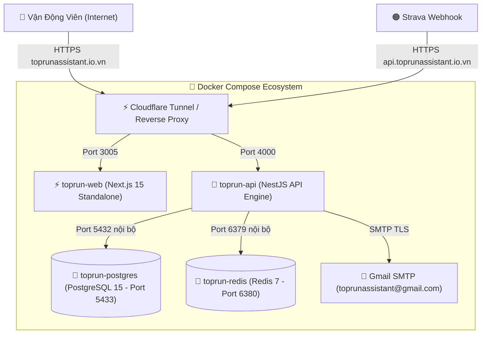

# 🚀 Hướng Dẫn Triển Khai, Cấu Hình Strava API & Vận Hành Hệ Thống TOPRunAssistant

Tài liệu hướng dẫn kỹ thuật toàn diện cho nền tảng **TOPRunAssistant** (Giải chạy ảo Virtual Race & Đồng bộ Strava Tracklog tự động) với tên miền chính thức **`toprunassistant.io.vn`** và hòm thư hệ thống **`toprunassistant@gmail.com`**.

---

## 1. Thông Tin Cấu Hình Hệ Thống Chính Thức

| Hạng mục | Giá trị cấu hình | Ghi chú |
| :--- | :--- | :--- |
| **Tên miền Web Runner** | `https://toprunassistant.io.vn` | Frontend Next.js (Port `3005:3000`) |
| **Tên miền Backend API & Webhook** | `https://api.toprunassistant.io.vn` | NestJS API Engine (Port `4000:4000`) |
| **Hòm thư hệ thống (SMTP)** | `toprunassistant@gmail.com` | Gửi link kích hoạt & mã OTP 6 số |
| **Mật khẩu ứng dụng Gmail (App Password)** | `ocyh hckx fwrn mdak` | Đã cấu hình trong `.env` |
| **Cơ sở dữ liệu (PostgreSQL)** | Port `5433` (Container `toprun-postgres`) | Tránh trùng cổng 5432 mặc định |
| **Bộ nhớ đệm (Redis)** | Port `6380` (Container `toprun-redis`) | Tránh trùng cổng 6379 mặc định |
| **Mã ứng dụng Strava API (Client ID)** | `292007` | Ứng dụng chính thức TOPRun Assistant |
| **Strava Webhook Verification Token** | `TOPRUN_STRAVA_VERIFY_TOKEN_2026` | Dùng đăng ký push notification |

### Tài Khoản Quản Trị Viên (Admin) Khởi Tạo Mặc Định:
- **Tài khoản (Email)**: `admin@toprun.vn`
- **Mật khẩu mặc định**: `TopRun@2026`
- **Họ và tên**: Alan Hoàng (System Admin)
- **Vai trò (Role)**: `ADMIN` (Toàn quyền quản trị hệ thống, tạo giải đấu, duyệt thành viên, cấu hình quy chế và kiểm duyệt tracklog)

---

## 2. Kiến Trúc Triển Khai Docker Toàn Diện (4 Containers)

Toàn bộ hệ sinh thái TOPRunAssistant được đóng gói chuẩn hóa bằng **Docker Compose**:



### Các Lệnh Quản Trị Docker Compose Chuẩn:

```powershell
# 1. Khởi chạy toàn bộ 4 dịch vụ ngầm (Background)
docker compose up -d

# 2. Xem log theo thời gian thực của toàn bộ hệ thống
docker compose logs -f

# 3. Xem log riêng của Backend API hoặc Web Frontend
docker compose logs -f api
docker compose logs -f web

# 4. Kiểm tra trạng thái sức khỏe (Healthcheck) của các container
docker compose ps

# 5. Dừng hệ thống khi không sử dụng
docker compose down
```

---

## 3. Chiến Lược Triển Khai 2 Giai Đoạn

| Tiêu chí | Giai Đoạn 1: Cloudflare Tunnel (Thử nghiệm 0đ) | Giai Đoạn 2: VPS Linux Production (Khởi tranh giải) |
| :--- | :--- | :--- |
| **Mục đích** | Thử nghiệm nội bộ (< 100 VĐV), test luồng Strava thật | Vận hành giải chạy chính thức, 24/7 không gián đoạn |
| **Hạ tầng** | Máy tính cá nhân hiện tại (Windows) | Máy chủ VPS Linux (Ubuntu 22.04 LTS) |
| **Chi phí máy chủ** | **0 đồng / tháng ($0)** | **~90.000đ – 150.000đ / tháng** |
| **Tên miền & SSL** | `toprunassistant.io.vn` (HTTPS tự động qua Cloudflare) | `toprunassistant.io.vn` (HTTPS tự động qua Cloudflare) |
| **Công cụ điều phối**| `cloudflared.exe` (Windows Service ngầm) | Docker Compose (`docker-compose.yml`) + `deploy.sh` |
| **Thời gian duy trì** | Khi máy tính của bạn bật | Hoạt động 24/7/365 trên Data Center |

---

## 4. GIAI ĐOẠN 1: Kích Hoạt Cloudflare Tunnel Trên Máy Local (0đ Chi Phí)

Máy tính Windows của bạn **đã có sẵn công cụ `cloudflared.exe`** tại `C:\Program Files (x86)\cloudflared\cloudflared.exe`.

### Bước 1: Tạo Đường Hầm Trên Cloudflare Zero Trust
1. Đăng nhập trang: **[https://one.dash.cloudflare.com/](https://one.dash.cloudflare.com/)**
2. Vào **Networks** ➔ chọn **Tunnels** ➔ nhấn **Add a tunnel**.
3. Chọn **Cloudflared** ➔ Đặt tên: `toprun-tunnel` ➔ nhấn **Save tunnel**.

### Bước 2: Cài Đặt Token Lên Máy Tính
1. Tại tab **Windows**, sao chép dòng lệnh cài đặt do Cloudflare cấp:
   ```powershell
   cloudflared.exe service install <TOKEN_DO_CLOUDFLARE_CAP>
   ```
2. Mở **PowerShell (Run as Administrator)** trên máy tính của bạn, dán lệnh vào và nhấn **Enter**.
3. Trạng thái trên Cloudflare sẽ chuyển sang **Connected (Xanh lá)** ➔ nhấn **Next**.

### Bước 3: Định Tuyến 2 Tên Miền Con (Public Hostnames)
- **Hostname 1 (Web Runner)**:
  - Subdomain: *(để trống hoặc nhập @)*
  - Domain: `toprunassistant.io.vn`
  - Type: `HTTP`
  - URL: `localhost:3005`
- **Hostname 2 (API & Strava Webhook)**:
  - Subdomain: `api`
  - Domain: `toprunassistant.io.vn`
  - Type: `HTTP`
  - URL: `localhost:4000`

---

## 5. Cấu Hình Email SMTP (Gmail Kích Hoạt Kép: Link + OTP)

Hệ thống đã được tích hợp luồng kích hoạt tài khoản kép:
1. **Liên kết kích hoạt trực tiếp**: Người dùng bấm nút "Kích Hoạt Tài Khoản Ngay" trong email để tự động xác thực và đăng nhập.
2. **Mã OTP 6 chữ số**: Dành cho người dùng mở email trên thiết bị khác, có thể nhập trực tiếp mã OTP vào giao diện để kích hoạt ngay mà không cần chuyển trình duyệt.

Thông số cấu hình chuẩn trong file [`.env`](file:///c:/Users/thuang/OneDrive%20-%20ASSA%20ABLOY%20Group/alan/TOPRunAssistant/.env):
```env
SMTP_HOST="smtp.gmail.com"
SMTP_PORT=587
SMTP_SECURE=false
SMTP_USER="toprunassistant@gmail.com"
SMTP_PASS="ocyhhckxfwrnmdak"
SMTP_FROM='"TOPRun Assistant" <toprunassistant@gmail.com>'
```

---

## 6. Cấu Hình Strava Developers Production & Webhook Tự Động

### Bước 1: Cập Nhật Callback Domain
1. Đăng nhập: **[https://www.strava.com/settings/api](https://www.strava.com/settings/api)**
2. Nhấn nút **Edit** và điền:
   - **Authorization Callback Domain**: `api.toprunassistant.io.vn`
3. Nhấn **Save**.

### Bước 2: Đăng Ký Webhook Subscription Với Strava
Khi tên miền `https://api.toprunassistant.io.vn` đã online, chạy lệnh curl sau để Strava tự động bắn bài chạy về hệ thống mỗi khi VĐV hoàn thành buổi chạy:

```bash
curl -X POST https://www.strava.com/api/v3/push_subscriptions \
  -F client_id=292007 \
  -F client_secret=54eb7308f454c98fb5e452edb41f1108afb66b10 \
  -F callback_url=https://api.toprunassistant.io.vn/api/v1/webhooks/strava \
  -F verify_token=TOPRUN_STRAVA_VERIFY_TOKEN_2026
```

---

## 7. GIAI ĐOẠN 2: Triển Khai Lên VPS Linux Production (Khi Giải Khởi Tranh)

Khi cần đưa hệ thống chạy 24/7 độc lập trên máy chủ ảo:
1. Thuê VPS Ubuntu 22.04 LTS (2 CPU, 2-4GB RAM, ~100k/tháng tại Vietnix/CloudFly/Linode).
2. Trỏ 2 bản ghi `A` (`@` và `api`) trên Cloudflare về IP của VPS.
3. Chạy các lệnh cài đặt trên VPS:
   ```bash
   # Cài Docker & Công cụ mạng
   curl -fsSL https://get.docker.com -o get-docker.sh && sh get-docker.sh
   apt install -y git curl ufw
   ufw allow OpenSSH && ufw allow 80/tcp && ufw allow 443/tcp && ufw --force enable

   # Kéo mã nguồn & Khởi động toàn bộ dịch vụ
   git clone <URL_REPO_GITHUB> /var/www/TOPRunAssistant
   cd /var/www/TOPRunAssistant
   cp .env.example .env
   docker compose up -d
   ```

---

## 8. Hướng Dẫn Vận Hành Tính Năng Dành Cho Runner & Admin

### 8.1. Dành Cho Vận Động Viên (Runner)
- **Đăng ký tài khoản**: Truy cập `https://toprunassistant.io.vn/register`, nhập họ tên, email, mật khẩu.
- **Kích hoạt tài khoản kép**:
  - Cách 1: Bấm nút xác thực trong email từ `toprunassistant@gmail.com`.
  - Cách 2: Nhập mã OTP 6 số hiển thị trong email vào trang xác thực.
- **Đăng nhập nhanh**: Hỗ trợ đăng nhập bằng Google Auth (tự động kích hoạt tài khoản không cần chờ email).
- **Cách ly dữ liệu Tracklog cá nhân**: VĐV chỉ thấy bài chạy của chính mình, đảm bảo tính riêng tư tuyệt đối.
- **Đồng bộ Strava**: Vào tab **"Hồ sơ & Kết nối Strava"** ➔ Nhấn **"Kết Nối Strava Ngay"** để uỷ quyền OAuth2.
- **Xem Tracklog & Phân tích Splits**: Tab **"Nhật ký & Tracklog"** hiển thị chi tiết pace từng km, bản đồ GPS, nhịp tim và cự ly hợp lệ.

### 8.2. Dành Cho Ban Tổ Chức & Admin
- **Quản lý Đa Giải Đấu (Multi-Event)**: Tạo và quản trị nhiều giải đấu độc lập cùng lúc. Tùy chỉnh ngày bắt đầu/kết thúc, Pace min/max, nhân hệ số cuối tuần cho từng giải.
- **Tự Động Tính Điểm Khớp Khung Giờ**: Bài chạy chỉ được tự động tính vào giải nếu diễn ra trong khoảng thời gian diễn ra giải đấu mà VĐV đã đăng ký.
- **Quản trị & Phân quyền VĐV**: Tab **"Quản trị & Kiểm duyệt"** ➔ Phân vai trò `RUNNER`, `ORGANIZER`, `ADMIN`.
- **Kiểm duyệt Chống Gian Lận (Anti-Cheat)**: Tự động phát hiện và cắt bỏ các km có tốc độ bất thường (quên tắt đồng hồ đi xe máy, gian lận cự ly).
- **Xuất đơn hàng Race-Kit**: Tải file CSV giao hàng (Áo Finisher, Huy chương khắc tên) để chuyển tiếp đơn vị vận chuyển (GHTK/GHN).
