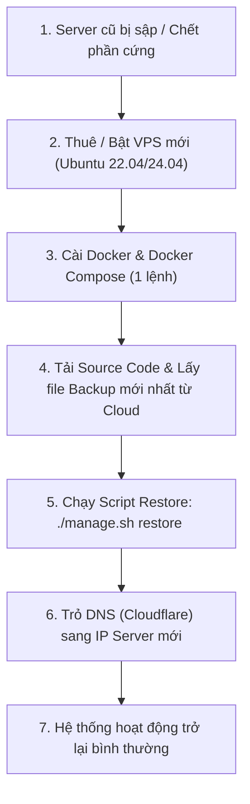

# Hướng Dẫn Sao Lưu & Phục Hồi Thảm Họa (Disaster Recovery & Backup Guide)

> **Dự án:** TOPRunAssistant — Hệ thống Quản trị Giải chạy & Đồng bộ Strava  
> **Phiên bản tài liệu:** v1.0 (Cập nhật 11/2026)  
> **Mục tiêu:** Đảm bảo hệ thống có thể khôi phục 100% dữ liệu và hoạt động trở lại trong vòng **dưới 15 phút** khi máy chủ vật lý/VPS bị sập, cháy nổ, hoặc phải chuyển gấp sang nhà cung cấp hạ tầng khác.

---

## 1. Chiến Lược Sao Lưu (Backup Architecture: 3-2-1 Rule)

Hệ thống áp dụng chuẩn an toàn dữ liệu công nghiệp **3-2-1**:
- **3 Bản sao:** Bản trực tiếp đang chạy trên Database + Bản nén lưu trên máy chủ hiện tại (Local) + Bản lưu trữ từ xa (Cloud/NAS).
- **2 Phương tiện:** Ổ đĩa cứng SSD của Server + Đám mây Object Storage (Cloudflare R2 / AWS S3 / Google Drive / Synology NAS).
- **1 Bản Off-site độc lập:** Đặt ở trung tâm dữ liệu khác hoàn toàn với server chính để phòng ngừa server chính chết đột ngột.

### Chỉ số cam kết an toàn:
| Chỉ số | Định nghĩa | Cam kết của hệ thống |
| :--- | :--- | :--- |
| **RPO (Recovery Point Objective)** | Lượng dữ liệu tối đa chấp nhận mất mát | **Tối đa 12 giờ** (Do cronjob chạy 2 lần/ngày: 00:00 & 12:00) |
| **RTO (Recovery Time Objective)** | Thời gian đưa hệ thống chạy lại từ con số 0 | **Dưới 15 phút** (Khi đã có VPS mới và file backup) |

---

## 2. Thành Phần Trong Mỗi Gói Backup

File backup được nén theo định dạng `toprun_backup_YYYYMMDD_HHMMSS.tar.gz` bao gồm trọn gói:
1. `toprun_db.dump`: Bản xuất toàn diện PostgreSQL sử dụng định dạng nhị phân chuẩn `pg_dump -F c` (lưu trữ đầy đủ Schema, Sequences, Tables, Relations, Custom Views, Indexes).
2. `data/`: Thư mục lưu trữ tệp trạng thái engine (`toprun-engine-state.json`), cache tính toán, GPX/FIT tracklogs và hình ảnh uploads.
3. `.env.backup`: Toàn bộ biến môi trường, khóa mã hóa bảo mật JWT, Strava Client ID & Secret, cấu hình SMTP Email, mật khẩu Database.
4. `backup_manifest.json`: Siêu dữ liệu gồm thời gian tạo, tên database, cấu hình compose, số ngày lưu trữ để kiểm tra tính toàn vẹn khi phục hồi.

---

## 3. Cách Thực Hiện Sao Lưu (Backup)

### 3.1. Sao lưu thủ công tức thì (Manual Backup)
Khi cần nâng cấp tính năng lớn, chỉnh sửa database hoặc chuẩn bị bảo trì:

**Trên Linux / VPS Production:**
```bash
# Cách 1: Qua bộ công cụ quản trị hệ thống
./manage.sh backup

# Cách 2: Chạy trực tiếp script
./scripts/backup.sh --prod
```

**Trên Windows (PowerShell):**
```powershell
# Cách 1: Qua manage.ps1
.\manage.ps1 backup

# Cách 2: Chạy trực tiếp script
.\scripts\backup.ps1 -Prod
```

Bản backup sau khi tạo sẽ nằm tại thư mục: `./backups/toprun_backup_YYYYMMDD_HHMMSS.tar.gz`.

---

### 3.2. Cài đặt Sao lưu Tự Động Định Kỳ (2 lần/ngày: 00:00 & 12:00)

Trên máy chủ Linux (Ubuntu / Debian), mở bảng lập lịch cronjob của tài khoản quản trị (hoặc `root`):

```bash
crontab -e
```

Thêm dòng sau vào cuối file:

```cron
# ==============================================================================
# TOPRunAssistant - Tự động backup 2 lần/ngày (12:00 trưa và 00:00 đêm)
# Tự động nén DB + Data + .env, dọn dẹp bản ghi cũ hơn 7 ngày và đẩy lên Cloud/NAS
# ==============================================================================
0 0,12 * * * cd /opt/TOPRunAssistant && /bin/bash ./scripts/backup.sh --prod >> /opt/TOPRunAssistant/logs/backup.log 2>&1
```

> **Ghi chú về đường dẫn:** Thay `/opt/TOPRunAssistant` bằng đường dẫn thư mục cài đặt thực tế của bạn trên server (ví dụ `/root/TOPRunAssistant` hoặc `/home/ubuntu/TOPRunAssistant`).

#### Theo dõi nhật ký backup:
```bash
tail -f /opt/TOPRunAssistant/logs/backup.log
```

---

## 4. Tự Động Đẩy Bản Sao Lên Cloud / NAS Synology (Rclone)

Script `backup.sh` đã tích hợp sẵn tính năng tự động đẩy file backup lên lưu trữ đám mây qua công cụ đa nền tảng **Rclone**.

### Bước 1: Cài đặt Rclone trên Linux VPS
```bash
sudo -v ; curl https://rclone.org/install.sh | sudo bash
```

### Bước 2: Cấu hình nơi lưu trữ (Remote Storage)
Chạy lệnh tương tác:
```bash
rclone config
```
Hoặc tạo trực tiếp file `~/.config/rclone/rclone.conf` dựa trên mẫu `scripts/rclone.conf.example`.

#### Khuyên dùng 1: Cloudflare R2 (Bảo mật, chuẩn S3, 0đ cước tải về / Zero Egress)
```ini
[r2]
type = s3
provider = Cloudflare
access_key_id = 9a8b...
secret_access_key = 1c2d...
endpoint = https://<ACCOUNT_ID>.r2.cloudflarestorage.com
acl = private
```

#### Khuyên dùng 2: NAS Synology (Qua WebDAV hoặc SFTP)
```ini
[synology]
type = webdav
url = https://nas.domaincuaban.com:5006/Backups/TOPRunAssistant
vendor = other
user = admin_nas
pass = <mat_khau_rclone_obscure>
```

### Bước 3: Kích hoạt trong file `.env` của TOPRunAssistant
Thêm biến môi trường vào file `.env`:
```env
# Đẩy lên Cloudflare R2 bucket toprun-backups:
RCLONE_REMOTE=r2:toprun-backups

# Hoặc đẩy về NAS Synology:
# RCLONE_REMOTE=synology:Backups/TOPRunAssistant
```

Khi biến này được thiết lập, mỗi khi script backup chạy (cả bằng tay lẫn qua cronjob), file backup sẽ được tự động đồng bộ lên Cloud/NAS ngay lập tức.

---

## 5. KỊCH BẢN PHỤC HỒI THẢM HỌA: KHI SERVER SẬP & CHUYỂN SANG SERVER MỚI

Nếu Server hiện tại bị lỗi phần cứng không thể bật lại, datacenter gặp sự cố, bạn thực hiện quy trình **Disaster Recovery** sang Server mới theo 6 bước chuẩn hóa sau:



### Bước 1: Khởi tạo máy chủ mới (VPS mới)
- Hệ điều hành khuyến nghị: **Ubuntu 22.04 LTS** hoặc **Ubuntu 24.04 LTS**.
- Cấu hình đề xuất: Tối thiểu 2 vCPU, 4GB RAM, 40GB SSD.

### Bước 2: Cài đặt Docker & Docker Compose nhanh
Đăng nhập SSH vào VPS mới và chạy lệnh cài đặt chuẩn chính hãng:
```bash
curl -fsSL https://get.docker.com | sh
sudo systemctl enable --now docker
sudo usermod -aG docker $USER
```

### Bước 3: Tải mã nguồn TOPRunAssistant về máy chủ mới
```bash
git clone https://github.com/your-org/TOPRunAssistant.git /opt/TOPRunAssistant
cd /opt/TOPRunAssistant
```

### Bước 4: Lấy file backup mới nhất từ Cloud Storage về VPS mới
Tùy vào dịch vụ lưu trữ bạn dùng:
- **Nếu dùng Rclone:**
  ```bash
  # Liệt kê các bản backup trên Cloud:
  rclone lsd r2:toprun-backups

  # Tải bản backup mới nhất về thư mục backups/:
  mkdir -p backups
  rclone copy r2:toprun-backups/toprun_backup_YYYYMMDD_HHMMSS.tar.gz ./backups/
  ```
- **Nếu lưu trên NAS hoặc máy cá nhân:** Bạn có thể dùng `scp` để tải lên VPS mới:
  ```bash
  scp toprun_backup_YYYYMMDD_HHMMSS.tar.gz root@<IP_SERVER_MOI>:/opt/TOPRunAssistant/backups/
  ```

### Bước 5: Thực hiện lệnh Khôi phục (Restore)
Chạy lệnh khôi phục:
```bash
./manage.sh restore backups/toprun_backup_YYYYMMDD_HHMMSS.tar.gz
```
Hệ thống sẽ hỏi bạn xác nhận:
```text
⚠️  CẢNH BÁO NGUY HIỂM: TIẾN TRÌNH KHÔI PHỤC DỮ LIỆU (DISASTER RESTORE)
Bạn có chắc chắn muốn khôi phục không? Nhập chính xác 'RESTORE' để tiếp tục: RESTORE
```
*(Nếu muốn chạy tự động không cần hỏi, thêm cờ `-y` hoặc `--force`)*:
```bash
./manage.sh restore backups/toprun_backup_YYYYMMDD_HHMMSS.tar.gz -y
```

**Quá trình script thực hiện tự động:**
1. Giải nén và kiểm tra tính toàn vẹn gói backup.
2. Khôi phục file cấu hình môi trường `.env`.
3. Khởi động PostgreSQL Container và chờ database sẵn sàng.
4. Ngắt toàn bộ kết nối hiện hữu và phục hồi toàn bộ bảng, dữ liệu, sequence bằng `pg_restore`.
5. Khôi phục thư mục `./data` (engine cache, state JSON, uploads).
6. Khởi động toàn bộ cụm container (API, Web, Nginx) và kiểm tra trạng thái hoạt động.

### Bước 6: Trỏ DNS Tên Miền sang IP Server mới
1. Đăng nhập vào trình quản lý DNS (Cloudflare, Namecheap, v.v.).
2. Sửa địa chỉ **IP A-Record** của:
   - `toprunassistant.io.vn` ➔ `<IP_SERVER_MỚI>`
   - `api.toprunassistant.io.vn` ➔ `<IP_SERVER_MỚI>`
3. Do hệ thống sử dụng Nginx reverse proxy, ngay khi DNS cập nhật, người dùng truy cập lại bình thường.

### Bước 7: Danh sách kiểm tra sau khôi phục (Post-Restore Checklist)
Kiểm tra các hạng mục sau:
- [ ] Chạy `./manage.sh status` xem toàn bộ container (`api`, `web`, `postgres`, `redis`, `nginx`) đều ở trạng thái `Up (healthy)`.
- [ ] Đăng nhập tài khoản Vận động viên / Quản trị viên trên web giao diện.
- [ ] Kiểm tra danh sách giải chạy (Tournaments) và bảng xếp hạng (Leaderboards).
- [ ] Kiểm tra kết nối Strava Webhook: Vận động viên đồng bộ hoạt động mới kiểm tra tính hợp lệ.

---

## 6. Chính Sách Xoay Vòng Lưu Trữ (Retention Policy)

- **Cục bộ trên Server (Local):** Tự động xóa các bản lưu cũ hơn **7 ngày** nhằm tiết kiệm dung lượng ổ cứng máy chủ. Bạn có thể thay đổi số ngày này qua biến môi trường `BACKUP_RETENTION_DAYS` trong `.env` (ví dụ: `BACKUP_RETENTION_DAYS=14`).
- **Trên Cloud Storage / NAS:** Nên bật tính năng Lifecycle Rule:
  - Giữ toàn bộ backup trong 30 ngày.
  - Tự động chuyển các file > 30 ngày sang tầng lưu trữ giá rẻ (ví dụ: AWS S3 Glacier Instant Retrieval hoặc Cloudflare Infrequent Access) hoặc xóa sau 60 ngày.

---

## 7. Xử Lý Sự Cố Thường Gặp (Troubleshooting)

### Q1: Bị lỗi `pg_restore: error: input file does not appear to be a valid archive`?
- **Nguyên nhân:** File dump bị ngắt quãng khi tải hoặc đường dẫn file truyền vào chưa đúng.
- **Khắc phục:** Kiểm tra kích thước file backup bằng `ls -lh backups/`. Thử mở file bằng `tar -tzf backups/<ten_file>.tar.gz` để chắc chắn không bị hỏng cấu trúc nén.

### Q2: Container PostgreSQL báo lỗi cổng hoặc quyền truy cập khi restore?
- **Nguyên nhân:** Mật khẩu trong file `.env` khác với mật khẩu đang có của volume cũ.
- **Khắc phục:** Script `restore.sh` đã tự động khôi phục đúng file `.env.backup` đi kèm bản sao lưu để đảm bảo tuyệt đối khớp mật khẩu `POSTGRES_PASSWORD` và `POSTGRES_USER`.

### Q3: Muốn backup thử nghiệm trên môi trường máy tính Windows cá nhân?
- **Khắc phục:**
  ```powershell
  .\manage.ps1 -Local backup
  # Hoặc restore:
  .\manage.ps1 -Local restore backups\toprun_backup_xxx.tar.gz
  ```

